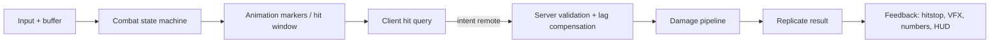

# MOC: Combat Systems

> **TL;DR:** A server-authoritative combat stack, end to end. **Input** (buffered, platform-agnostic) → **state machine** (what you're allowed to do) → **animation-timed hit windows** → **hit detection** (raycast/shapecast/overlap/projectile) → **server validation** (lag-compensated) → **damage resolution** (block/parry/i-frames, status, knockback) → **feedback** (hitstop, shake, VFX, numbers, HUD). The client predicts for feel, the server decides for fairness.

## 1. Input & intent
[[Input_Action_System]] · [[UserInputService_and_ContextActionService]] · [[Combo_Systems_and_Input_Buffering]] · [[Cross_Platform_UI_Input]]

## 2. State & rules
[[Finite_State_Machines]] · [[Combat_State_Machine]] · [[Server_Authoritative_Cooldowns]] · [[Status_Effects]] · [[Combat_System_Architecture]]

## 3. Timing & animation
[[Animation_System]] · [[Animation_Events_and_Markers]] · [[Fixed_Timestep_and_Tick_Rate]]

## 4. Hit detection
[[Hitbox_Detection_Methods]] · [[Raycasting]] · [[Shapecasting]] · [[Spatial_Queries_Overlap]] · [[Raycast_Hitbox_Module]] · [[Projectile_Systems]] · [[Collision_Groups_and_Filtering]]

## 5. Validation & netcode
[[Hit_Validation]] · [[Lag_Compensation]] · [[Server_Side_Validation]] · [[Remote_Rate_Limiting]] · [[Client_Prediction_and_Reconciliation]] · [[Server_Authority_Model]] · [[UnreliableRemoteEvent]] · [[Blink_IDL]] · [[Network_Bandwidth_Budget]]

## 6. Resolution
[[Damage_Pipeline]] · [[Block_Parry_and_IFrames]] · [[Knockback_and_Ragdoll]] · [[Status_Effects]]

## 7. Feel & feedback
[[Hitstop_and_Impact_Feel]] · [[Camera_Shake]] · [[Client_Side_VFX_Replication]] · [[VFX_Composition_and_Timing]] · [[Damage_Numbers_and_Hit_Markers]] · [[Cooldown_and_Ability_UI]] · [[Custom_HUD_Design]] · [[Audio_API]]

## 8. Shipping it
Balance live with [[Configs_Remote_Configuration]], test changes with [[Experiments_and_AB_Testing]], keep PvP fair under [[Monetization_Design_Principles]], and harden against [[Auto_Farm_and_Remote_Spam_Exploits]].

## Related hubs
[[Home]] · [[MOC_Game_Systems_and_Algorithms]] · [[MOC_Anti_Exploit]] · [[MOC_VFX_and_Weather]] · [[MOC_Movement_and_ODM]] · [[MOC_UI_UX_and_Components]]

## Sources
- Each linked note cites its own primary sources. See [[Trusted_Sources]].
